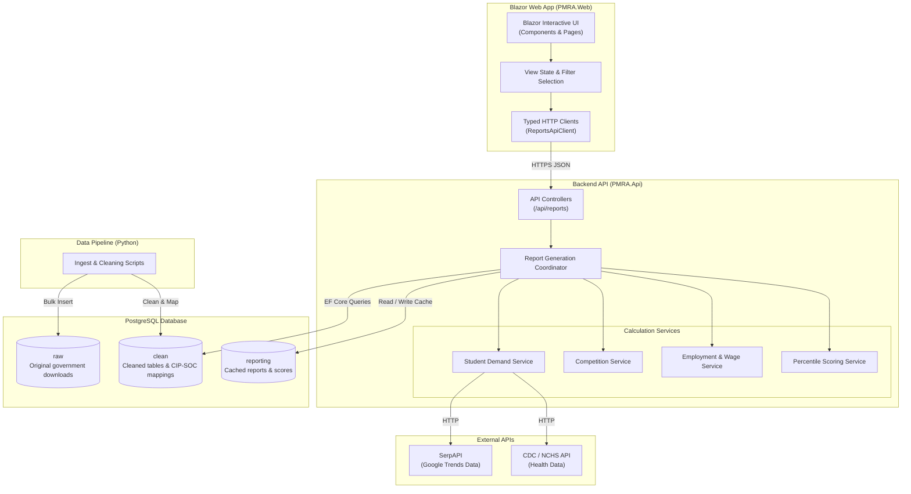
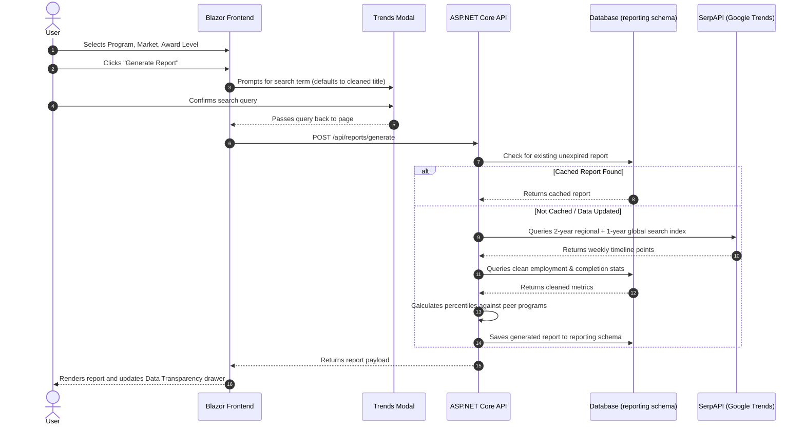

# Application Architecture

## System Diagram

The application is structured into four main layers: the Blazor frontend, the ASP.NET Core Web API, a multi-schema PostgreSQL database, and a background Python data pipeline.

---

## How the Pieces Fit Together

### 1. Blazor Frontend (`PMRA.Web`)
* The frontend is built with Blazor and talks to the backend strictly over HTTP via typed API clients.
* We kept all database logic and heavy math out of the client. The frontend's job is purely to collect user filter selections (program, market, award level), show progress spinners while calculations run, render the report sections, and display provenance metadata when a user clicks on a number.

### 2. ASP.NET Core Web API (`PMRA.Api`)
* When a user requests a report, the `ReportGenerationService` acts as a traffic cop.
* It first checks the `reporting` database schema to see if a report with those exact parameters already exists.
* If a cached report is found and the underlying data hasn't been updated since it was built, it returns the report immediately.
* If it's a new query or the dataset was recently updated, the coordinator calls the individual calculation services (`StudentDemand`, `Competition`, `Employment`), queries SerpAPI for live search trends, computes percentile scores, saves the result to the cache, and sends it back.

### 3. Three-Schema Database Design
Rather than dumping everything into one flat schema, we split PostgreSQL into three isolated areas:
1. `raw`: Contains unedited raw data directly as downloaded from federal files (IPEDS, BLS). This makes it easy to audit source data without re-downloading files.
2. `clean`: Tables after our Python pipeline standardizes data types, normalizes institution names, and runs the CIP-to-SOC career crosswalks.
3. `reporting`: Materialized reports and calculated metric scores. This allows instant loading for frequently requested programs.

---

## Report Generation Flow

