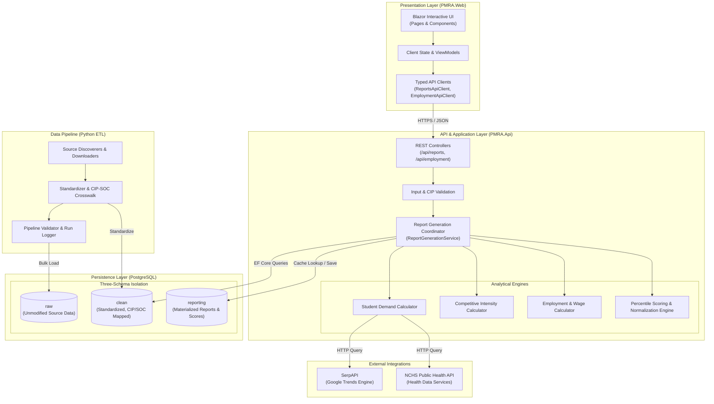
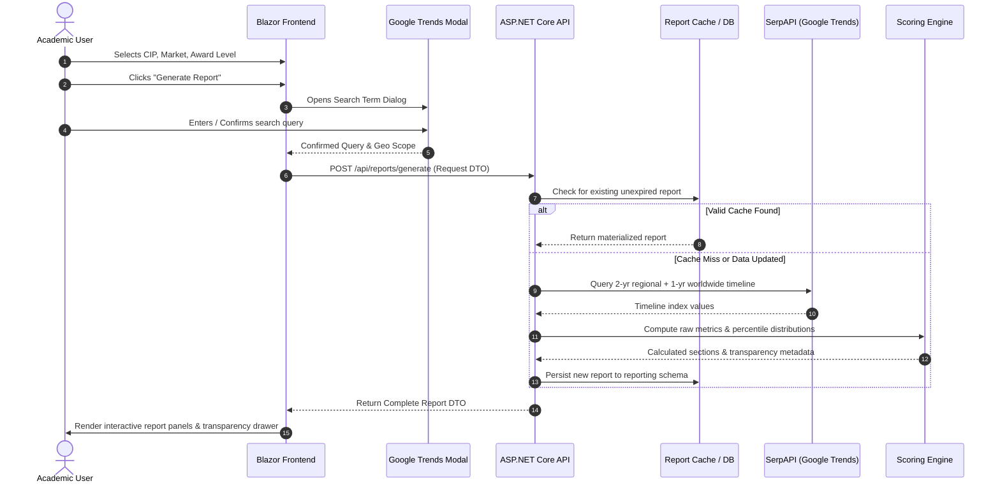

# Application Architecture

## System Overview

The **Program Market Research Application (PMRA)** is engineered as a decoupled, multi-tier system. The architecture separates presentation, API orchestration, analytical calculation, data persistence, and external data ingestion to maximize modularity and maintainability.

---

## Architectural Principles & Constraints

### 1. Hard Separation of Concerns
* **No Direct DB Access from UI**: The Blazor frontend operates strictly over HTTP calling ASP.NET Core endpoints. It has zero knowledge of database connections or underlying database schemas.
* **Service Independence**: Calculation services (e.g., `EmploymentCalculator`, `ReportScoringCalculator`) operate against standardized DTOs and interfaces, allowing scoring logic to be unit tested without live database or network dependencies.

### 2. Multi-Schema Database Isolation
The database is deliberately structured into three distinct schemas:
1. `raw`: Direct mirror of external downloads (IPEDS completions, BLS wage tables). Preserves original source integrity.
2. `clean`: Normalized and standardized data. Maps heterogeneous source IDs to unified CIP (Classification of Instructional Programs) and SOC (Standard Occupational Classification) codes.
3. `reporting`: Materialized reports and calculated percentile scores. Supports instant cache retrieval and historical report versioning.

### 3. Report Caching & Staleness Invalidation
To balance responsive performance with fresh data:
* When a report is requested for a specific `(CIP Code, Market, Award Level, Rubric)` tuple, the API first checks `reporting.Reports`.
* If a stored report exists and was generated after the latest data refresh (tracked by the pipeline run log), the cached report is returned immediately.
* If the underlying dataset has been refreshed or no report exists, the calculation engines execute, persist the result, and return the newly materialized report.

### 4. Resilient External Service Design
* Calls to external services like SerpAPI (Google Trends) are isolated behind strict interface contracts (`IGoogleTrendsService`).
* Configurable timeouts, error handling, and parameter validation prevent external third-party outages from crashing core report generation.

---

## Request & Report Generation Lifecycle

