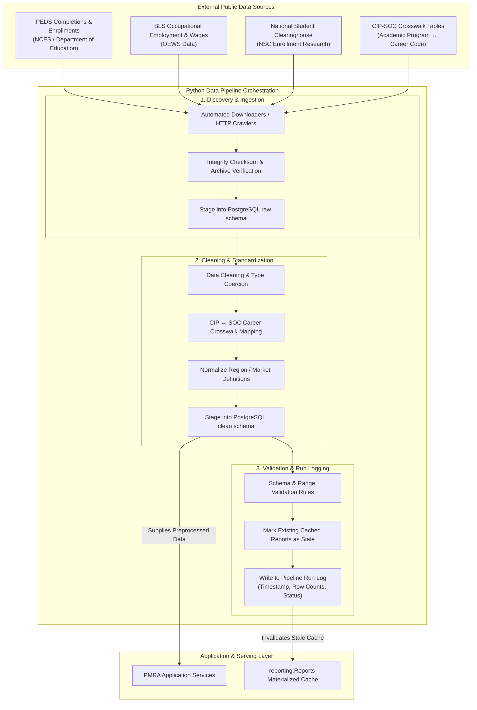
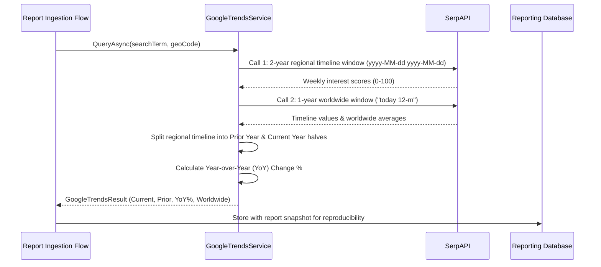

# Data Collection & Pipeline Workflow

## Overview

A fundamental requirement of the **Program Market Research Application (PMRA)** is deterministic, preprocessed data availability: academic administrators must never experience latency or timeouts due to live multi-gigabyte government file downloads when requesting a report.

To achieve this, PMRA utilizes an automated Python-based ETL (Extract, Transform, Load) data pipeline that processes public datasets on a scheduled cadence (typically semi-annually aligned with federal release schedules) or via manual administrative trigger.

---

## Data Pipeline Lifecycle

---

## Ingestion Stages Explained

### 1. Discovery & Automated Download
* **Isolated Source Readers**: Each data provider (BLS, IPEDS, NSC) has a dedicated ingest reader. This isolates vendor-specific file format anomalies (CSV variations, fixed-width headers, Excel multi-sheet structures).
* **Deterministic Versioning**: The pipeline tracks release dates and hashes to avoid redundant processing of unchanged data archives.
* **Raw Archival**: Unmodified data is archived into the `raw` schema, ensuring complete traceability and enabling re-processing if cleaning logic is revised.

### 2. Standardization & CIP-to-SOC Crosswalk
* **The Semantic Bridge**: Higher education degree classifications are structured according to **CIP** (Classification of Instructional Programs) codes (e.g., `11.0101 - Computer and Information Sciences`). Labor and wage statistics are categorized by **SOC** (Standard Occupational Classification) codes (e.g., `15-1252 - Software Developers`).
* **Crosswalk Translation**: The pipeline applies official federal crosswalks, weighted mappings, and regional groupings to tie degree completions directly to career wage percentiles (10th, 25th, Median, 75th, 90th percentiles) and projected job openings.

### 3. Pipeline Run Log & Cache Invalidation
* Every pipeline run records an immutable entry in the `PipelineRunLog` table containing:
  * Execution timestamp and duration
  * Source datasets ingested and row counts
  * Status (Success / Partial / Failure)
* **Automatic Cache Invalidation**: The report generation service references this log. If the latest successful pipeline run timestamp is newer than a stored report's generation date, the cached report is flagged as historical/stale, prompting an automated re-calculation on demand.

---

## Live Data Integration: Google Trends (SerpAPI)

Unlike historical demographic and labor data, consumer and student search interest changes weekly. Search interest is retrieved on demand via SerpAPI's Google Trends engine:

This hybrid model combines the speed and stability of preprocessed federal data with the responsiveness of live consumer interest indicators.
