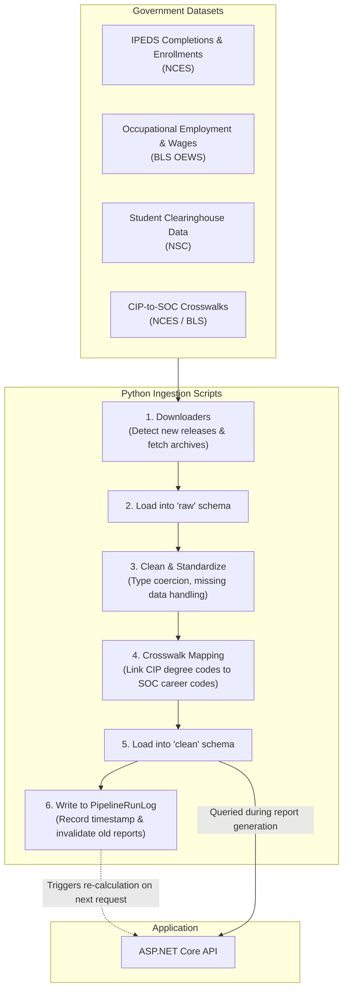

# Data Collection & Pipeline Workflow

## Why We Preprocess the Data

Government education and labor datasets (like IPEDS and BLS OEWS) are huge—often several gigabytes across multiple CSV, fixed-width, and Excel files. 

One of our early architectural decisions was: **users should never wait for an external file to download while generating a report**. All primary datasets are ingested, cleaned, and stored in our database ahead of time. When an administrator clicks "Generate Report", the system is only running calculations on pre-cleaned local tables, making generation fast and reliable.

---

## Pipeline Workflow

---

## Key Pipeline Steps

### 1. Ingestion & Raw Staging
Each government source has its own Python module. This keeps source-specific quirks isolated—for example, handling changes in BLS column names between survey years or unpacking IPEDS ZIP archives. The raw data is saved into the database's `raw` schema so we have an exact audit trail of what was originally downloaded.

### 2. The CIP-to-SOC Career Crosswalk
This was one of the most interesting data engineering challenges on the project:
* Universities describe degrees using **CIP** (Classification of Instructional Programs) codes (e.g., `11.0701 - Computer Science`).
* The Bureau of Labor Statistics describes jobs and salaries using **SOC** (Standard Occupational Classification) codes (e.g., `15-1252 - Software Developers`).

A single degree might prepare students for multiple careers, and a single career might draw graduates from multiple degrees. Our pipeline applies federal crosswalk mappings to link CIP programs to their corresponding SOC codes, allowing us to accurately display 10th, 25th, Median, 75th, and 90th percentile wages for each program.

### 3. Pipeline Run Log & Cache Invalidation
When the pipeline finishes running, it logs an entry into the `PipelineRunLog` table with:
* The run timestamp.
* Datasets updated and row counts.
* Success or error status.

The web API checks this timestamp. If an administrator views a report that was generated before the latest pipeline run, the app automatically flags it as historical and can recalculate it with the newest data.
