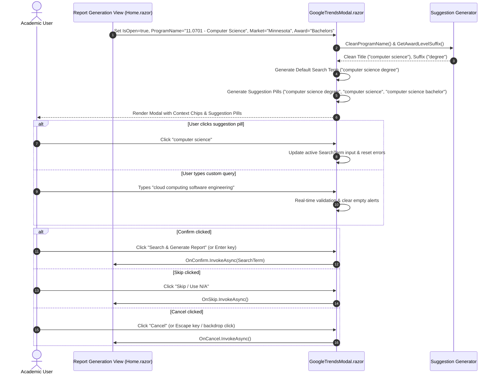

# Showcase: Blazor Frontend Component Architecture

## Architectural Context & User Experience Challenge

When academic administrators generate a Program Market Research report, the backend queries Google Trends to analyze prospective student interest. However:
1. Academic program names in the system are tied to formal CIP descriptions (e.g., `11.0701 - Computer Science.`).
2. If submitted directly to Google Trends, these strings yield poor or null results because consumers don't search using formal taxonomy prefixes.
3. Administrators need transparency: they must see what query is being executed, have the option to refine or customize it, click pre-computed smart suggestions, or skip external search if unneeded.

To provide a seamless, non-blocking user experience, I engineered the `GoogleTrendsModal` component using **Blazor Interactive Components**.

---

## Component Architecture & Interaction Flow

---

## Key Frontend Engineering Highlights

### 1. Robust State Management & Parameter Reactivity
* Uses Blazor's `OnParametersSet` lifecycle hook to detect when the parent view switches academic programs or award levels, automatically regenerating tailored query defaults and clearing stale validation state.
* Implements the **EventCallback Pattern** (`OnConfirm`, `OnSkip`, `OnCancel`), ensuring the modal remains a pure presentation/control component without hard coupling to specific API client services.

### 2. Defensive Text Sanitization & Smart Query Suggestions
* **Automated Stripping**: Automatically cleans catalog noise such as leading CIP codes (`"11.0701 - "`), trailing punctuation, and academic degree abbreviations.
* **Degree-Aware Suffixes**: Dynamically differentiates award levels—suggesting `"certificate"` suffixes for certificate programs, and `"degree"` or `"associate"` for undergraduate credentials.

### 3. Accessibility & Modern CSS
* **A11y Compliant**: Configured with `role="dialog"`, `aria-modal="true"`, `aria-labelledby`, and clear focus trap semantics.
* **Keyboard Navigation**: Native `Enter` and `Escape` key handling via `@onkeydown` event bindings.
* **Scoped CSS**: Isolated styles utilizing modern glassmorphism backdrop filters (`backdrop-filter: blur(4px)`), smooth CSS transitions, and responsive mobile-first flexbox layouts.

---

## Included Files in this Example
* [`GoogleTrendsModal.razor`](GoogleTrendsModal.razor): The complete Blazor component definition and C# code-behind logic.
* [`GoogleTrendsModal.razor.css`](GoogleTrendsModal.razor.css): Scoped styles, animations, chip badges, and pill button transitions.
