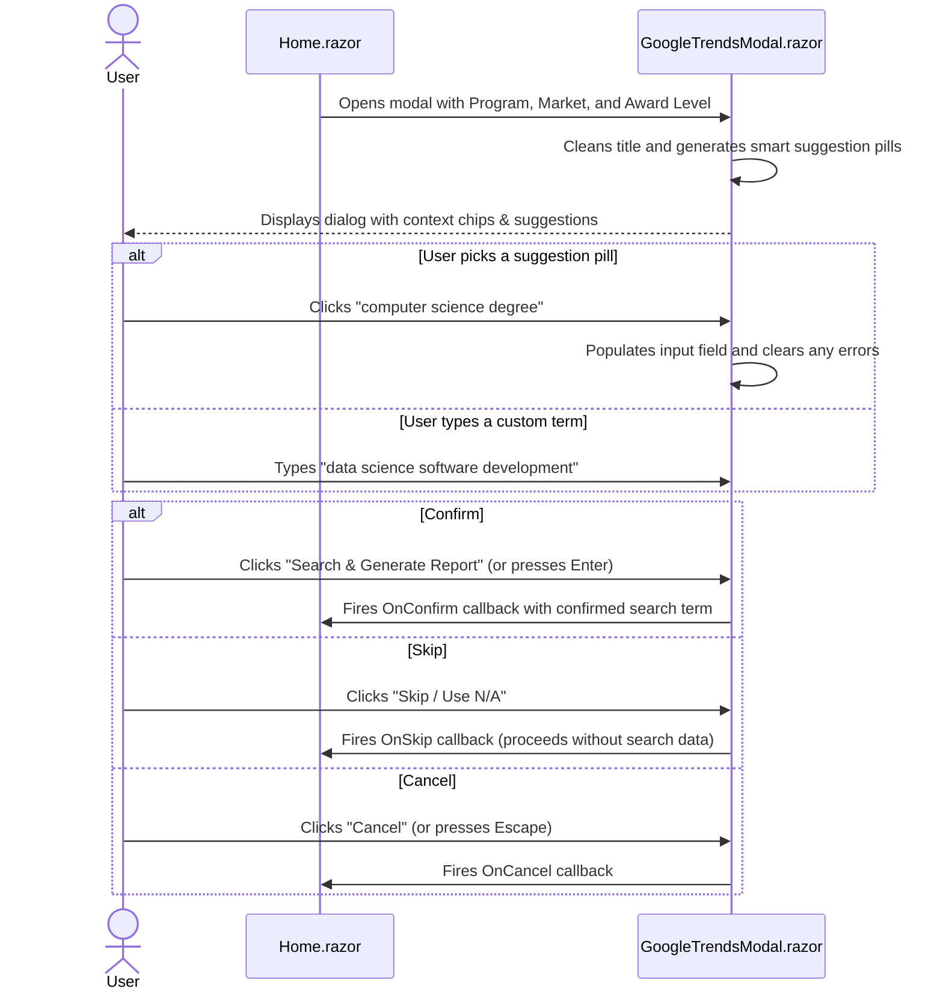

# Example: Blazor Frontend Component (`GoogleTrendsModal`)

## Why This Component Was Needed

Because academic degree titles (like `"11.0701 - Computer Science."`) don't match how prospective students search online, we couldn't just blindly fire backend API calls with the raw catalog title.

We needed a clean, non-intrusive way to:
1. Strip out catalog noise (CIP codes, dashes, trailing periods).
2. Suggest natural phrases students actually search (e.g., adding `"degree"`, `"certificate"`, or `"bachelor"` based on the award level).
3. Let the user edit the search term or pick a quick suggestion before the report is generated.
4. Allow users to skip Google Trends completely if they only want federal data.

I built `GoogleTrendsModal.razor` in Blazor to handle this step.

---

## How It Works

---

## Engineering Details

* **Blazor Component Lifecycle**: Uses `OnParametersSet` to detect when the parent view passes a new program or award level, automatically generating new query suggestions and resetting validation errors.
* **Decoupled Callbacks**: The component doesn't know about HTTP clients or API endpoints. It communicates with the parent view strictly through `EventCallback<string>` (`OnConfirm`, `OnSkip`, `OnCancel`), keeping it modular and easy to test.
* **Keyboard Navigation**: Handles `Enter` (confirm) and `Escape` (cancel) natively through `@onkeydown` bindings for smooth keyboard workflow.
* **Scoped Styling**: Custom CSS with a blurred backdrop (`backdrop-filter`), pill buttons, and responsive context chips matching the university's color palette.

---

## Files in this Directory
* [`GoogleTrendsModal.razor`](GoogleTrendsModal.razor): The Razor template and C# component logic.
* [`GoogleTrendsModal.razor.css`](GoogleTrendsModal.razor.css): The component-scoped CSS styles.
