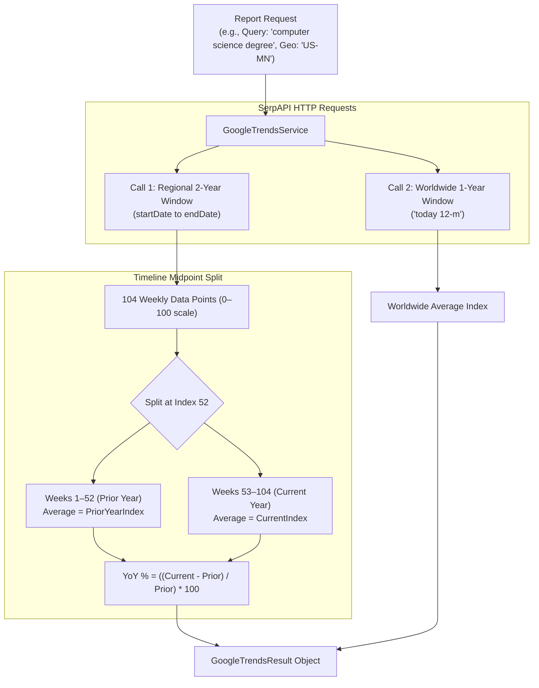

# Example: Google Trends & SerpAPI Integration

## The Problem

When universities evaluate student interest in a degree, Google search trends are a great indicator of real-world demand. But adding Google Trends to our report pipeline came with two big hurdles:

1. **Academic Titles vs. Everyday Searches**: Government catalogs use formal names like `11.0701 - Computer Science.` or `51.3801 - Registered Nursing/Registered Nurse`. If you query Google Trends for those exact strings, search volume is essentially zero. Real students search for terms like *"computer science degree"* or *"nursing bachelor program"*.
2. **Calculating Fair Year-over-Year (YoY) Change**: Google Trends doesn't output raw search volume—it returns relative scores from 0 to 100 normalized to the highest peak in whatever time window you request. If you make one call for "this year" and a separate call for "last year", the two scales don't match, and taking the difference produces meaningless percentages.

---

## How I Solved It

### The 2-Year Midpoint Split
Instead of making two separate queries for this year and last year, I requested a single **continuous 2-year window** from SerpAPI (`DateTime.UtcNow.AddYears(-2)` to `DateTime.UtcNow`).

Because the whole 2-year span is evaluated together, Google Trends normalizes all 104 weekly points against the same single baseline:
* **Points 0 to 51**: The prior year's weekly interest.
* **Points 52 to 103**: The current year's weekly interest.

Taking the average of each half gives two numbers on the exact same scale, allowing us to compute a mathematically valid Year-over-Year momentum percentage:
$$\text{YoY Change \%} = \frac{\text{CurrentAvg} - \text{PriorAvg}}{\text{PriorAvg}} \times 100$$

### Worldwide Baseline
A second lightweight query for `"today 12-m"` with no geographic filter provides a worldwide baseline index, showing leadership whether interest is purely regional or has international reach.

---

## Files in this Directory
* [`GoogleTrendsService.cs`](GoogleTrendsService.cs): The C# implementation with URL encoding, HTTP error handling, and the timeline splitting logic.
* [`IGoogleTrendsService.cs`](IGoogleTrendsService.cs): The service interface decoupling the report generator from the external API provider.
* [`GoogleTrendsModels.cs`](GoogleTrendsModels.cs): The DTOs returned to the report builder.
