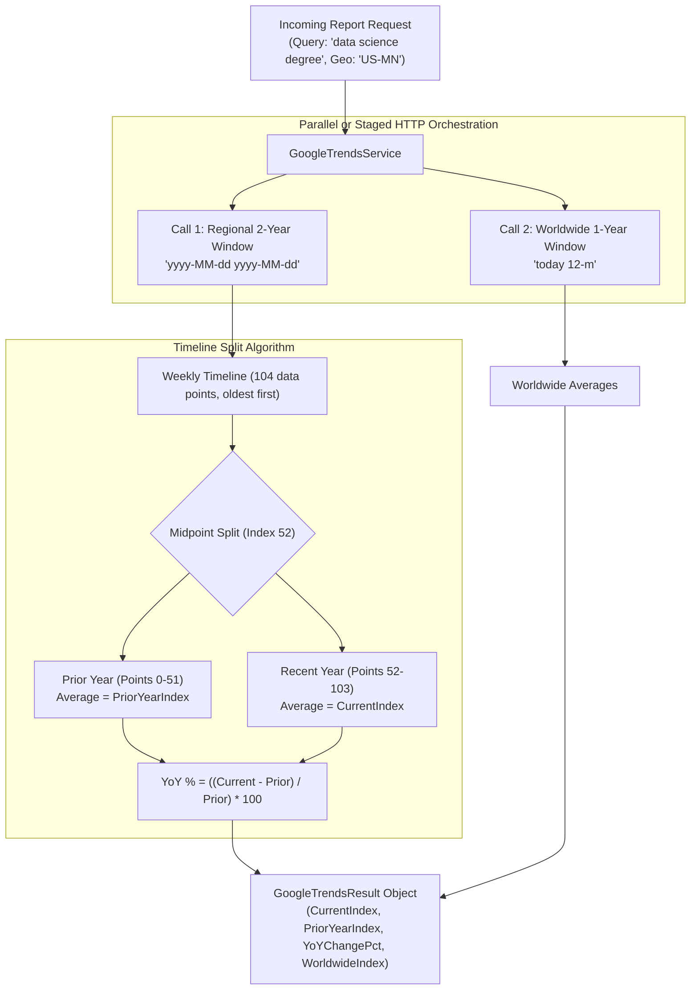

# Showcase: Google Trends & SerpAPI Integration

## Architectural Context & The Real-World Problem

When evaluating consumer demand for higher education academic programs, search engine momentum is an invaluable indicator of prospective student interest. However, integrating Google Trends data into an enterprise academic report posed three key technical challenges:

1. **Taxonomy Mismatch**: Academic institutions categorize programs via formal federal CIP codes (e.g., `11.0701 - Computer Science` or `51.3801 - Registered Nursing/Registered Nurse`). Prospective students, however, search for colloquial phrases like *"computer science degree"* or *"nursing bachelor program"*. Raw CIP titles yield virtually zero search volume on Google Trends.
2. **Deriving Meaningful YoY Growth**: Google Trends does not provide a built-in "Year-over-Year (YoY) Change" indicator. Standard queries return an index between 0 and 100 normalized to the peak point within that specific time window.
3. **Minimizing External Latency & API Costs**: Querying third-party APIs during report generation introduces network latency and per-call operational costs. Making excessive requests degrades the user experience.

---

## Technical Solution & Algorithm

To solve these constraints, I designed and implemented `GoogleTrendsService` with a specialized multi-window aggregation strategy:

### 1. Two-Year Regional Window Midpoint Split
Rather than making separate requests for "last year" and "this year" (which would normalize to different scales and make percentage comparisons mathematically invalid!), the service requests a single **two-year continuous timeline** (`DateTime.UtcNow.AddYears(-2)` to `DateTime.UtcNow`).

Because the 104 weekly data points are normalized by Google on the **same 0–100 baseline**, the timeline is split at the midpoint (`mid = points.Count / 2`):
* **Points 0 to 51**: Prior-year weekly relative interest.
* **Points 52 to 103**: Current-year weekly relative interest.
* **YoY Momentum**: Calculated directly as:
  $$\text{YoY Change \%} = \frac{\text{CurrentAvg} - \text{PriorAvg}}{\text{PriorAvg}} \times 100$$

### 2. Worldwide Baseline Comparison
A concurrent lightweight 1-year worldwide query (`"today 12-m"`) extracts the international demand index, giving university leadership visibility into whether a degree has global appeal or strictly domestic traction.

### 3. Production Hardening
* **Clean Deserialization Models**: SerpAPI's complex nested JSON structure is mapped to private, strongly typed records to prevent leaky internal abstractions.
* **Resilient Error & Key Handling**: Validates API secrets upfront via ASP.NET Core's `IOptions<GoogleTrendsOptions>` pattern and logs clean diagnostic telemetry.

---

## Included Files in this Example
* [`IGoogleTrendsService.cs`](IGoogleTrendsService.cs): The public service interface decoupling report generation from the external API provider.
* [`GoogleTrendsService.cs`](GoogleTrendsService.cs): The production service implementation with timeline splitting and HTTP orchestration.
* [`GoogleTrendsModels.cs`](GoogleTrendsModels.cs): The shared DTO contracts and request payloads.
